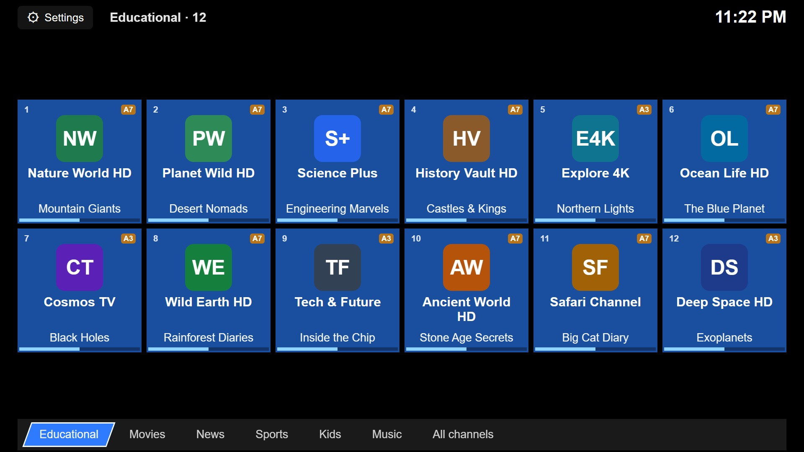
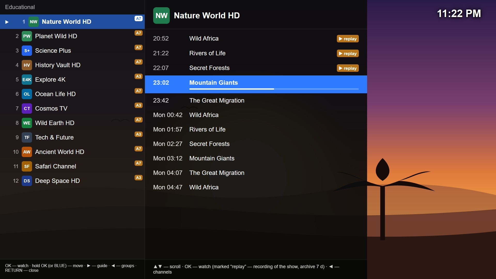
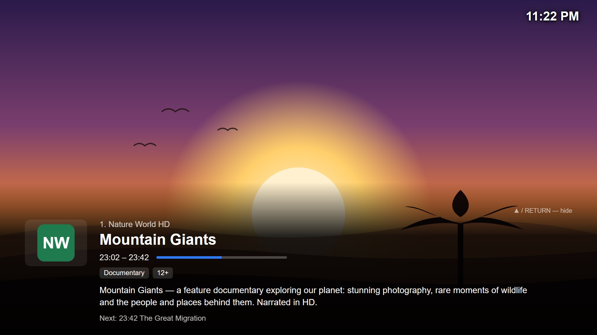
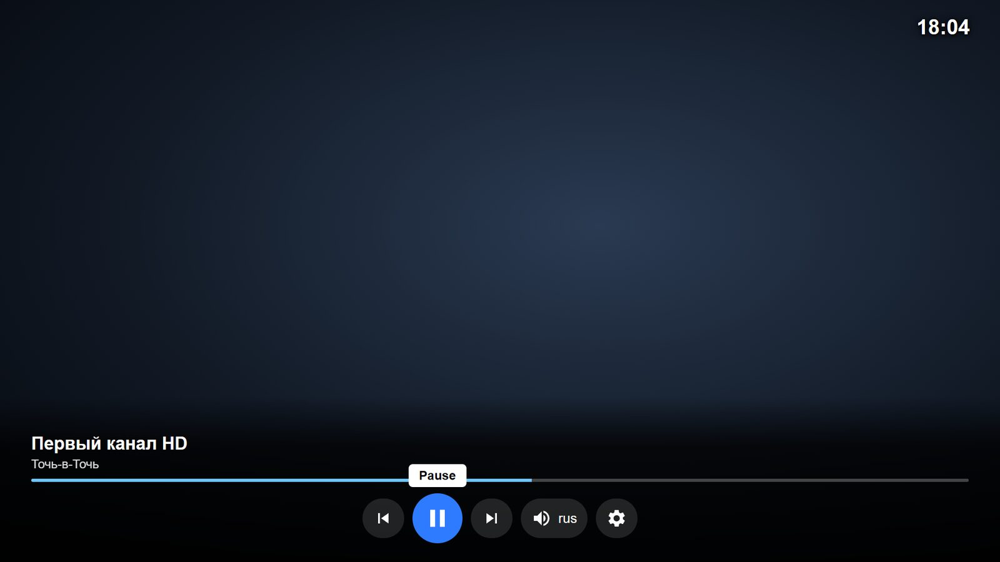
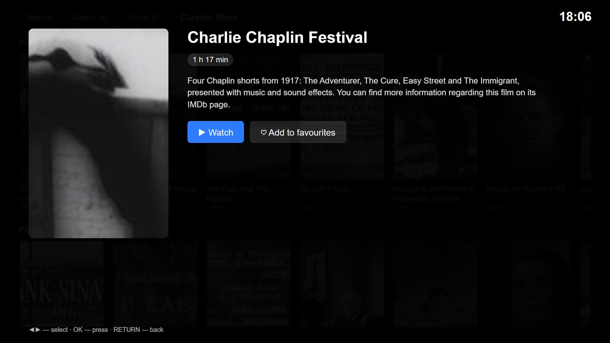

<p align="center"></p>
<p align="center">
  <a href="https://github.com/indoor25/AssisTV/actions/workflows/checks.yml"></a>
  <a href="LICENSE"></a>
  <a href="https://ko-fi.com/indoor25"></a>
</p>

# AssisTV — IPTV player for Samsung TVs, controlled from Home Assistant

🇷🇺 **[Русская версия](README.md)** · all guides in English live in [docs/en/](docs/en/)

A custom IPTV player for Samsung (Tizen) TVs and a Home Assistant add-on that goes with it.

> **AssisTV is free and open-source software.** It contains and sells no channels, movies or
> subscriptions: you connect your own sources that you have the right to use. Websites selling
> "AssisTV subscriptions" have nothing to do with this project.

## What it looks like

<p align="center">
  <a href="docs/screenshots/en-home.jpg"></a>
  <a href="docs/screenshots/en-list-epg.jpg"></a><br>
  <a href="docs/screenshots/en-info.jpg"></a>
  <a href="docs/screenshots/en-bar.jpg"></a><br>
  <a href="docs/screenshots/en-vod.jpg"></a>
  <a href="docs/screenshots/en-vod-card.jpg"></a><br>
</p>

<p align="center"><sub>Shots from a test bench: channels — a sample playlist, movies — the <a href="plugins/archive-org/README.en.md">Internet Archive</a> plugin. The add-on page in Home Assistant — <a href="docs/screenshots/en-addon.jpg">here</a>.</sub></p>

## Why it exists

Ready-made IPTV players for Samsung TVs (OTT Player and the like) show channels just fine, but you cannot
control them from outside: you cannot say "put BBC One on in the bedroom", and your smart home has no idea
what is on. This player does everything the usual ones do and is fully controllable from Home Assistant:
with buttons on a dashboard, with automations, by voice, or by typing to the assistant (Assist).

## What it looks like in real life

You talk to a smart speaker or type in the Home Assistant chat, in plain words:

| You | What happens |
|-----|--------------|
| "Put BBC One on in the bedroom" | the bedroom TV turns itself on, the player starts, the channel plays |
| "What's on right now?" | "Channel 4 — the News, until 8 pm" |
| "Play it from the start" | the show that is already running starts from its beginning (from the archive) |
| "When is the football today?" | finds the programme across all channels; "remind me" — reminds you 5 minutes before |
| "Play Interstellar in 4K" | finds the movie in all sources and plays it in that quality |
| "What's the rating of Dune?" | Kinopoisk and TMDB scores and a short summary |
| "Add this to favourites" | the movie that is playing goes to your favourites |
| "Find me movies based on my favourites" | a page with posters, ratings and descriptions appears over the picture — pick one with the remote or say "play the second one" |
| "More options" | a new selection, without what was already shown and what you have already watched |
| "Turn the TV off in half an hour" | sleep timer |

All examples with explanations are in **[docs/en/usage.md](docs/en/usage.md)**.

## Features

**Live TV**

- **Your own playlist** (M3U) from your IPTV provider; several playlists with switching.
- **TV guide** (EPG) for every channel, from one or several XMLTV sources; programme description on ▲.
- **Channel logos** — from the EPG, replaceable with your own.
- **Groups and channel order**: a home screen with tiles, your own channel order (remembered).
- **Archive / catch-up** (past programmes) if your provider has it: seek, pause, "from the start",
  rewinding straight from live TV.
- **Sleep timer**: the TV turns itself off; the sound fades out during the last minute.
- **Programme reminders**: a notice on the screen and a spoken reminder 5 minutes before the start.
- **Parental control**: channel groups behind a PIN.

**Movies and series**

- **Source plugins**: your provider's video portal and others; a new source is one file — no need to
  reinstall the app on the TV. A ready example with no keys —
  [Internet Archive](plugins/archive-org/README.en.md): public-domain film classics.
- Search, filters, "continue watching", episode, quality and audio-version selection.
- **Kinopoisk and TMDB ratings**, genres, descriptions; **viewer reviews** on a separate screen.
- **Favourites** shared by all TVs, all sources and the Home Assistant card.
- **Suggestions based on favourites**: the AI assistant picks movies to your taste and shows them as a page
  of posters over the picture; what you have watched is not offered again.

**Control**

- **Samsung remote**: regular and media keys; works with the new remotes that have no colour buttons.
- **Languages**: English, Russian, Ukrainian, German. Adding yours — [lang/README.md](lang/README.md).
- **Home Assistant**:
  - a dashboard card: what is on, channels, volume, archive, movies and favourites, TV power;
  - every TV is a separate device in HA (channel, programme, volume, buttons);
  - **voice and chat through Assist** with any AI (Google Gemini, OpenAI, DeepSeek, a local model…);
  - several TVs: a command goes to the right one by name or room; a TV that is off is turned on.

## How it works

```
 IPTV provider                  Home Assistant (Raspberry Pi or another computer)
 ─────────────                  ──────────────────────────────────────────────────
 M3U playlist  ────────►  ┌──  add-on "AssisTV"  ───────────┐
 EPG guide     ────────►  │    prepares channels and guide  │
 movies        ────────►  │    knows every TV               │
                          │                                 │
                          │    Mosquitto (MQTT)  ◄── IPTV card, Assist, automations
                          └────────────┬────────────────────┘
                                       │  home network
                        ┌──────────────┴──────────────┐
                 Samsung TV (player)           Samsung TV (player)
```

- A provider's TV guide is huge (hundreds of megabytes) — a TV cannot digest it. The add-on parses it on the
  Home Assistant machine and hands the TV a small ready-made file.
- The TV finds the add-on, registers itself and receives the playlists. Commands from Home Assistant reach
  it through the Mosquitto MQTT broker.
- The voice assistant knows nothing about TVs: it calls ready-made scripts, and the add-on decides which TV
  to turn on, where to look for the movie and what to answer.

## What you need

| What | Why |
|------|-----|
| A Samsung Tizen TV, 2017 or newer (2017–2020 — with the special `-Legacy` build) | the player runs on it |
| Home Assistant OS (Raspberry Pi 4/5, mini PC, virtual machine) | the add-on and the control; you need the "Apps" section (called "Add-ons" in older versions) |
| An IPTV playlist (M3U link) from your provider | channels |
| A TV guide link (XMLTV, `.xml` or `.xml.gz`) | EPG; providers often give one |
| A Windows, macOS or Linux computer | to build and install the app on the TV once |
| A free Samsung account | a certificate for installing an app on your own TV |

Optional but nice: free **TMDB** and **Kinopoisk** keys (ratings and reviews) and an AI assistant in Home
Assistant (voice and chat).

## Installation — step by step

Follow the steps in order; each one is a separate guide:

The add-on repository is added to Home Assistant with one button:

[](https://my.home-assistant.io/redirect/supervisor_add_addon_repository/?repository_url=https%3A%2F%2Fgithub.com%2Findoor25%2FAssisTV)


1. **[The add-on in Home Assistant](docs/en/install-ha-addons.md)** — Mosquitto, the Samsung TV integration,
   the "AssisTV" add-on, your playlists and EPG.
2. **[The app on the TV](docs/en/install-tv.md)** — Tizen Studio, developer mode, certificate, build and
   install, first start.
3. **[The card on a Home Assistant dashboard](docs/en/ha-dashboards.md)** — control from a phone or computer.
4. **[Voice and chat (Assist)](docs/en/assist.md)** — so that you can type or say "put BBC One on".

After that:

- **[docs/en/usage.md](docs/en/usage.md)** — how to use it: remote, archive, movies, favourites, card, voice;
- [docs/en/addon-iptv.md](docs/en/addon-iptv.md) — every add-on option, mapping channels to the guide,
  parental control, MQTT requests for your own automations;
- [docs/en/vod-plugins.md](docs/en/vod-plugins.md) — movie sources: how to install a plugin and how to write one;
- [docs/voice-search.md](docs/voice-search.md) — how the player understands spoken channel names, and how
  to teach it your language;
- [docs/en/backup.md](docs/en/backup.md) — updating the player and the add-on, backups.

## What is in the repository

| Folder / file | What it is |
|---------------|-----------|
| `index.html`, `js/`, `css/`, `config.xml`, `libs/` | the TV app |
| `ha-addon/epg_builder/` | the Home Assistant add-on |
| `ha-addon/deploy.ps1` | installs and updates the add-on from your computer with one command (for those who edit the code) |
| `ha-config/iptv-assist-scripts.yaml` | Home Assistant scripts for voice and chat |
| `ha-config/iptv-voice-duck.yaml` | sample automation: mute the TV while the speaker is listening |
| `ha-config/lovelace-tv-view.example.yaml` | sample dashboard view with the card |
| `repository.yaml` | lets you add the repository to the Home Assistant app store |
| `lang/` | interface translations (ru, en, uk, de) and how to add a language |
| `docs/`, `docs/en/` | guides in Russian and in English |
| `tools/` | building the TV package (`build-wgt.ps1`) and checks that need no TV: channel search, TV guide, movie sources, translations |

## Support the project

AssisTV is free and will stay free. If it is useful to you, you can buy the author a coffee at
**[ko-fi.com/indoor25](https://ko-fi.com/indoor25)** — the same QR code is on the TV: Settings → **About**.
Bug reports and ideas in [Issues](https://github.com/indoor25/AssisTV/issues) help just as much.

## Passwords and personal data

There are none in the repository. The playlist link (usually with a personal token) and the keys for movie
sources and ratings are entered in the add-on options in Home Assistant; the TV gets its MQTT password from
the add-on. The code and the examples use `example.com` instead of real addresses.

A note on names: the interface is translated, but the default option values and many comments in the code
are in Russian — that is the author's language. The player itself picks English when the TV menu is in a
language it has no translation for.
